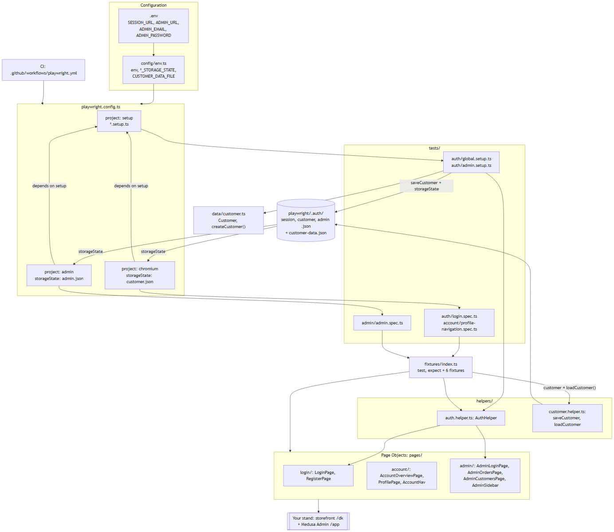

# 4. Verify: сверка с реальностью

Паттерн задания: **черновик → сверка с реальностью → именное подтверждение**. Сверяем с тем, как код и стенд ведут себя сейчас, а не с текстом старого README.

## 4.1 Чистое окружение: ONBOARDING дословно

**Где проходили:**
- `git clone --branch main` локального репо в пустую папку scratchpad.
- Поверх наложены изменения ветки: README, `package.json`, lockfile, `docs/`.
- Нет `node_modules`, `.env` и `playwright/.auth`.
- Команды взяты из ONBOARDING как есть, в PowerShell.
- Лог: [runs/onboarding-clean-run.log](runs/onboarding-clean-run.log). URL стенда и email в логе скрыты.

| Шаг | Команда | Обещано в гайде | Факт |
|---|---|---|---|
| 1 | `node -v` | версия в `^20.19.0 \|\| ^22.13.0 \|\| >=24` | `v24.19.0` ✅ |
| 3 | `npm ci` | `added N packages`, без `EBADENGINE` | `exit=0`, `added 104 packages` ✅ |
| 4 | `npx playwright install chromium` | без ошибок | `exit=0` ✅ ⚠️ браузер уже был в кэше пользователя: загрузку «с нуля» на этой машине не проверить |
| 5 | `Copy-Item .env.example .env` + значения стенда | `.env` не виден в `git status` | не виден ✅ |
| 6 | `npm run lint`, `npm run typecheck` | exit 0 без вывода | оба `exit=0` ✅ |
| 7 | `npx playwright test --project=setup` | `2 passed`, 4 файла в `playwright/.auth/` | `2 passed`; `admin.json, customer-data.json, customer.json, session.json` ✅ |
| 8 | `npm test` | `7 tests` (2 setup + 5) | `Running 7 tests using 1 worker` → `7 passed` ✅ |
| 8 | `… login.spec.ts --no-deps` | файл без setup | `Running 2 tests` → `2 passed` ✅ |
| 9 | `npm run report` | HTML-отчёт | `playwright-report/index.html` есть, `results.json`: expected=7, unexpected=0 ✅ |
| ✔ | Done-when: `git status` | `.env`, `playwright/` не видны | не видны ✅ |

**Отклонение в моей проверке, а не в документе.** Первый прогон шага 8 я сделала с `--reporter=list`, и отчёта не было: CLI-флаг заменяет репортеры из конфига. Повторный прогон дословно (`npm test`) создал отчёт.

## 4.2 Отрицательные сценарии из документации

| Утверждение в docs | Проверка | Результат |
|---|---|---|
| Без admin-кредов не запустится даже storefront (README Troubleshooting, ONBOARDING) | `ADMIN_EMAIL= ADMIN_PASSWORD= npx playwright test tests/auth/login.spec.ts` | `Missing env variable ADMIN_EMAIL`, `1 failed, 2 did not run` ✅ [runs/no-admin-creds.log](runs/no-admin-creds.log) |
| На Node 18 появится `EBADENGINE` | Node 18 на машине нет. Проверено по документации: npm (Context7 `/npm/cli/v11.17.0`) — корневой `engines` advisory; engines зависимостей (`eslint` `^20.19…`, `@playwright/test` `>=20`) дают warning | ✅ по документации, формулировка в ONBOARDING уточнена. ⚠️ не запуском |
| `--no-deps` пропускает setup | Документация Playwright 1.63 (Context7) + запуск 4.1 шаг 8 | ✅ |
| `--trace on` | `npx playwright test --help` | ✅ `--trace <mode>` |

## 4.3 Автоматическая сверка ссылок

Скрипт скилла `check-doc-refs.mjs` проверяет, что всё упомянутое в md существует:
- пути;
- `npm run` скрипты;
- `--project` имена;
- env-ключи;
- заявленную версию Node против engines зависимостей.

| Прогон | Файлы | Результат |
|---|---|---|
| До ([runs/check-refs-before.txt](runs/check-refs-before.txt)) | исходный README | **1 error**: `claims Node 18.0+ but @eslint/js needs at least 20.19` |
| После ([runs/check-refs-after.txt](runs/check-refs-after.txt)) | README + 3 docs | **0 errors**, 0 warnings, 12 info (сгенерированные файлы и исторические пути в CHANGELOG) |

Ложные срабатывания первой версии скрипта исправлены до финального прогона:
- голые имена файлов;
- имена npm-пакетов (`@eslint/js`, `dotenv/config`);
- имя ветки;
- старые пути в CHANGELOG.

Контрольно: исправленный скрипт на исходном README из `main` по-прежнему даёт ту же 1 ошибку, то есть проверка не ослаблена.

## 4.4 Архитектура против реальных классов

Каждый класс, функция и связь в [ARCHITECTURE.md](../../docs/ARCHITECTURE.md) сверены с исходниками. Все 9 Page Objects, `AuthHelper`, `createCustomer`, `saveCustomer`/`loadCustomer`, 6 фикстур, 3 проекта, 5 переходов навигации, правила ESLint — есть в коде. Слоёв, которых нет в коде, в документе нет.

Mermaid отрендерен Playwright + mermaid 11.4.1: `render ok, nodes: 18, edges: 22`.

## 4.5 Что не проверено и почему

- Установка Chromium «с нуля»: браузер уже в кэше пользователя.
- Поведение на Node 18 и 20.0–20.18: нет этих версий; проверено по документации npm.
- bash-варианты команд (`cp`): машина на Windows.
- CI: ветка не запушена. Триггеры и шаги сверены с `.github/workflows/playwright.yml` построчно.

## 4.6 Именное подтверждение

| Документ | Статус | Ревьюер |
|---|---|---|
| README.md | DRAFT | Hanna Koval — ожидает подтверждения |
| docs/ONBOARDING.md | DRAFT | Hanna Koval — ожидает подтверждения |
| docs/ARCHITECTURE.md | DRAFT | Hanna Koval — ожидает подтверждения |
| docs/CHANGELOG.md | DRAFT | Hanna Koval — ожидает подтверждения |

После подтверждения в шапке каждого документа строка `Status: DRAFT …` заменяется на `Reviewed by Hanna Koval, <дата>`.
