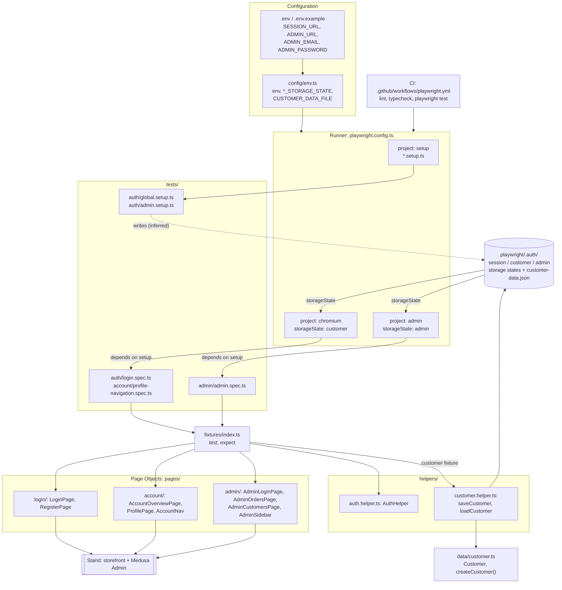

# Claude: описание архитектуры и диаграмма, шаблон №4 (дословно)

Входные данные: facts.md (файлы, конфиги, экспортируемые классы). Наша сверка — в [3-implement.md](../3-implement.md).

---

# Architecture

This is a Playwright Test (TypeScript) framework for UI tests against a per-user stand: a storefront (customer account) and Medusa Admin. It has six layers. Each one is a top-level folder or a root config file.

## Layers

| Layer | Files | What it contains |
|---|---|---|
| **Configuration** | `config/env.ts`, `.env` (template `.env.example`), `playwright.config.ts` | `env` (values from `SESSION_URL`, `ADMIN_URL`, `ADMIN_EMAIL`, `ADMIN_PASSWORD`) and the paths of the files saved under `playwright/.auth/`: `SESSION_STORAGE_STATE`, `CUSTOMER_STORAGE_STATE`, `ADMIN_STORAGE_STATE`, `CUSTOMER_DATA_FILE` |
| **Runner** | `playwright.config.ts`, `package.json` scripts, `.github/workflows/playwright.yml` | The Playwright Test runner. It defines three projects (`setup`, `chromium`, `admin`), runs 1 worker with `fullyParallel: false`, and writes `html` and `json` reports (`test-results/results.json`) |
| **Fixtures** | `fixtures/index.ts` | `test` (an extension of `base.extend<AuthFixtures>`) and a re-export of `expect`. It injects `authHelper`, `loginPage`, `accountPage`, `adminLoginPage`, `adminOrdersPage` and `customer` |
| **Page Objects** | `pages/login/`, `pages/account/`, `pages/admin/` | Pages: `LoginPage`, `RegisterPage`, `AccountOverviewPage`, `ProfilePage`, `AdminLoginPage`, `AdminOrdersPage`, `AdminCustomersPage`. Components: `AccountNav`, `AdminSidebar` |
| **Helpers** | `helpers/auth.helper.ts`, `helpers/customer.helper.ts` | `AuthHelper` (class). `saveCustomer()` and `loadCustomer()` save and read the customer data |
| **Test data** | `data/customer.ts` | The `Customer` interface and the `createCustomer()` factory |
| **Tests** | `tests/auth/`, `tests/account/`, `tests/admin/` | Setup: `global.setup.ts`, `admin.setup.ts`. Specs: `login.spec.ts`, `profile-navigation.spec.ts`, `admin.spec.ts` |

## How the layers interact

1. **Configuration.** `playwright.config.ts` loads `.env` through `dotenv/config` and imports `env` and the storage-state paths from `config/env.ts`. `baseURL` is set to `env.baseUrl`, the stand host taken from `SESSION_URL`. Page paths such as `/dk/account` are defined in the Page Objects, not in the config.
2. **Setup project.** The `setup` project runs the `*.setup.ts` files. The `chromium` and `admin` projects list `setup` as a dependency, so setup always runs first. According to the fixture comment, setup registers the customer on the stand. Inferred from the config constants and project wiring (not visible in the facts): setup saves the customer and admin sessions to `CUSTOMER_STORAGE_STATE` and `ADMIN_STORAGE_STATE`, and saves the customer data to `CUSTOMER_DATA_FILE` through `saveCustomer()`.
3. **Projects split the specs by area:**
   - `chromium` runs every spec outside `admin/` and starts each test logged in through `CUSTOMER_STORAGE_STATE`.
   - `admin` runs only `admin/*.spec.ts` and starts each test logged in through `ADMIN_STORAGE_STATE`.
4. **Fixtures.** Specs import `test` and `expect` from `fixtures/index.ts`. The fixtures create Page Objects and `AuthHelper` on top of Playwright's `page`. The `customer` fixture returns `loadCustomer()`, which means the specs reuse the customer that setup registered.
5. **Page Objects** are the only place where selectors and navigation are allowed. ESLint (`eslint.config.mjs`, applied to `tests/**/*.ts`) treats it as an error to call `locator` / `getBy*` / `$` / `$$` or `page.goto()` in tests. Setup files check that login succeeded with Page Object waits instead of `expect()`, so `playwright/expect-expect` is turned off for `*.setup.ts`. Pages that contain shared navigation use the components `AccountNav` and `AdminSidebar`.
6. **CI.** `.github/workflows/playwright.yml` runs `npm ci`, `lint`, `typecheck` and then `npx playwright test` with the secrets `SESSION_URL`, `ADMIN_URL`, `ADMIN_EMAIL` and `ADMIN_PASSWORD`. When `SESSION_URL` is not set, it skips the e2e tests. It uploads the `playwright-report` artifact.

The fixtures do not inject `ProfilePage`, `RegisterPage`, `AdminCustomersPage`, `AccountNav` or `AdminSidebar`. The facts do not show which files use them.

## Diagram

**Diagram description.** The configuration layer (`.env` → `config/env.ts`) feeds `playwright.config.ts`, which the runner uses locally and in CI. The runner starts the `setup` project first. Setup prepares the customer and admin sessions in `playwright/.auth/` (inferred from the config constants). The `chromium` and `admin` projects then run their specs with those sessions. Specs only use the fixtures from `fixtures/index.ts`. The fixtures build Page Objects (`pages/`) and `AuthHelper`, and the `customer` fixture loads the setup-registered `Customer` through `helpers/customer.helper.ts`. Only the Page Objects work with the stand UI, and ESLint enforces that rule.
