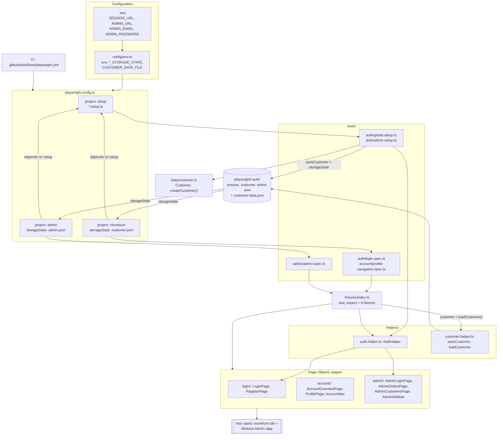

# Architecture

> **Status: DRAFT** — drafted by Claude, checked against the code on 2026-11-03 (commit `6b9b877`), pending review by Hanna Koval.

A Playwright Test (TypeScript) framework for UI tests against a per-user stand: the storefront (customer account, `/dk/...`) and Medusa Admin (`/app/...`). It has seven layers; each is a top-level folder or a root config file. There is no base page class, API client or logger: everything below exists in the repo.

## Layers

| Layer | Files | What it contains |
|---|---|---|
| **Configuration** | `config/env.ts`, `.env` (template `.env.example`) | `env`: lazy getters for `SESSION_URL`, `ADMIN_URL`, `ADMIN_EMAIL`, `ADMIN_PASSWORD` (`required()` throws `Missing env variable ...` on first access) and `env.baseUrl` (origin of `SESSION_URL`). Paths of saved sessions: `SESSION_STORAGE_STATE`, `CUSTOMER_STORAGE_STATE`, `ADMIN_STORAGE_STATE`, `CUSTOMER_DATA_FILE` (all under `playwright/.auth/`) |
| **Runner** | `playwright.config.ts`, `package.json` scripts, `.github/workflows/playwright.yml` | Three projects (`setup`, `chromium`, `admin`), 1 worker, `fullyParallel: false`, HTML + JSON reporters (`test-results/results.json`), `retries` 1 on CI |
| **Test data** | `data/customer.ts` | `Customer` interface and the `createCustomer()` factory (unique email `qa+<id>@example.test`) |
| **Page Objects** | `pages/login/`, `pages/account/`, `pages/admin/` | Pages: `LoginPage`, `RegisterPage`, `AccountOverviewPage`, `ProfilePage`, `AdminLoginPage`, `AdminOrdersPage`, `AdminCustomersPage`. Components: `AccountNav`, `AdminSidebar` |
| **Helpers** | `helpers/auth.helper.ts`, `helpers/customer.helper.ts` | `AuthHelper`: `openSession()` (with 403 / 5xx checks), `registerCustomer()`, `loginAsAdmin()`. `saveCustomer()` / `loadCustomer()` write and read `customer-data.json` |
| **Fixtures** | `fixtures/index.ts` | `test` (extends Playwright `test`) and re-exported `expect`. Fixtures: `authHelper`, `loginPage`, `accountPage`, `adminLoginPage`, `adminOrdersPage`, `customer` |
| **Tests** | `tests/auth/`, `tests/account/`, `tests/admin/` | Setup: `global.setup.ts`, `admin.setup.ts`. Specs: `login.spec.ts` (AUTH-01/02), `profile-navigation.spec.ts` (ACC-01), `admin.spec.ts` (ADM-01/02) |

## How the layers interact

1. **Configuration.** `playwright.config.ts` loads `.env` (`dotenv/config`) and sets `baseURL: env.baseUrl`. So `SESSION_URL` is read when the config loads: without it every command fails, even `--list`. The admin variables are read only when `admin.setup.ts` runs. Page paths (`/dk/account`, `/app/orders`) live in the Page Objects, not in the config.
2. **Setup project.** `setup` matches `*.setup.ts`, so it runs both setup files. `chromium` and `admin` have `dependencies: ['setup']`, so setup runs before any test — and its admin login is needed even for storefront-only runs. `--no-deps` skips it and reuses the files already in `playwright/.auth/`.
   - `global.setup.ts`: `AuthHelper.openSession()` → saves `session.json` → `createCustomer()` + `AuthHelper.registerCustomer()` → `saveCustomer()` → saves `customer.json`.
   - `admin.setup.ts` (timeout 90 s for a cold admin): `openSession()` → `loginAsAdmin()` (via `ADMIN_URL` if set, else `/app/login`) → saves `admin.json`.
   - Setup files use helpers and Page Objects directly, not fixtures.
3. **Projects split the specs.** `chromium` runs everything outside `tests/admin/` with `customer.json`; `admin` runs `tests/admin/*.spec.ts` with `admin.json`. A spec that tests the login itself overrides the session with `test.use({ storageState: SESSION_STORAGE_STATE })` (stand cookie, nobody logged in), as in `login.spec.ts` and the `Login` block of `admin.spec.ts`.
4. **Fixtures.** Specs import `test` and `expect` from `fixtures/index.ts`. Fixtures build Page Objects on the test's `page`; the `customer` fixture is `loadCustomer()`, i.e. the customer registered by setup. Specs also import `env` and the storage-state constants from `config/env.ts`.
5. **Page Objects.** Each class takes `page`, declares `readonly` locators in the constructor and exposes `goto()`, `waitForLoaded()` and actions. **Navigation returns the next Page Object**: `LoginPage.login()` → `AccountOverviewPage`, `LoginPage.openRegister()` → `RegisterPage`, `AccountOverviewPage.openProfile()` → `ProfilePage`, `AdminLoginPage.login()` → `AdminOrdersPage`, `AdminOrdersPage.openCustomers()` → `AdminCustomersPage`. Pages with shared navigation hold a component (`nav: AccountNav`, `sidebar: AdminSidebar`). Storefront locators use `data-testid`; Admin has none and uses roles / placeholders.
6. **Rules enforcement.** `eslint.config.mjs` applies to `tests/**/*.ts`: calling `locator` / `getBy*` / `$` / `$$` or `page.goto()` in tests is an error, as are `waitForTimeout`, `test.only`, `test.skip`. Setup files are exempt from `expect-expect` (they verify through Page Object waits).
7. **CI.** `.github/workflows/playwright.yml` (on push and manual dispatch, one run at a time) runs `npm ci` → `lint` → `typecheck`; if the `SESSION_URL` secret is set, also `npx playwright install --with-deps chromium` → `npx playwright test` → uploads `playwright-report/` and `results.json`.

## Diagram

**Diagram description.** Configuration (`.env` → `config/env.ts`) feeds `playwright.config.ts`, which runs the same way locally and in CI. `chromium` and `admin` both depend on `setup`, so setup runs first: through `AuthHelper` and `createCustomer()` it opens the stand, registers a customer, logs in to the admin and writes the sessions to `playwright/.auth/`. Each project then starts its tests with its session. Specs use only the fixtures (Page Objects, `AuthHelper`, `customer`) plus `env` and `SESSION_STORAGE_STATE` from `config/env.ts` (not drawn, to keep the diagram readable); only Page Objects touch the stand UI, and each navigation method returns the next Page Object. ESLint keeps selectors and `page.goto()` out of `tests/`.

## Where to add things

| You add | Put it in | Also |
|---|---|---|
| A new page or component | `pages/<area>/<name>.page.ts` / `.component.ts` | Return it from the navigation method that opens it; add a fixture in `fixtures/index.ts` only if specs start from it |
| New test data | `data/<entity>.ts` factory with unique values | Never hardcode emails: stand data persists between runs |
| A new spec | `tests/<area>/<name>.spec.ts`, import `test`/`expect` from `fixtures` | Add the case to the Test Cases table in the README; `tests/admin/` runs with the admin session |
| A new env variable | `config/env.ts` (`required()` or optional getter), `.env.example`, CI `env:` block | Document it in the README variables table |
